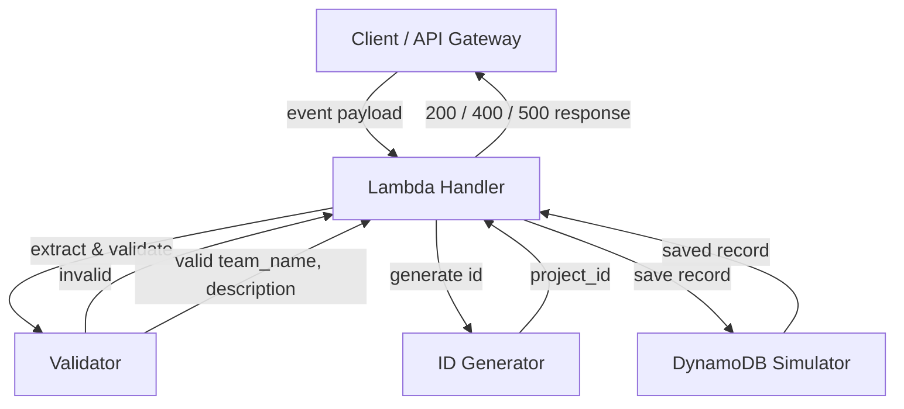
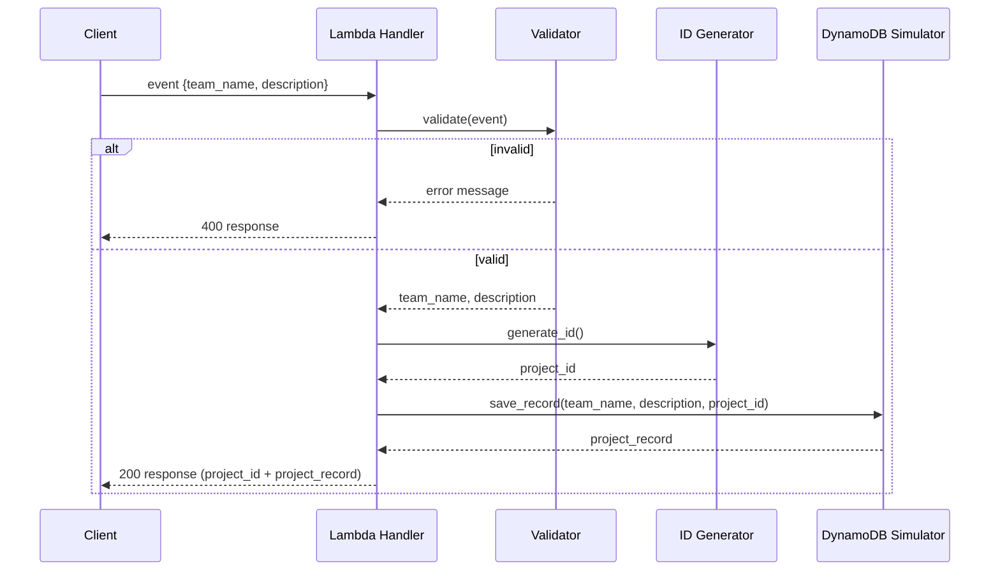

# Design Document

## Overview

This document describes the technical design for an AWS Lambda function written in Python that registers projects submitted by participating teams in a hackathon. The Lambda receives a team name and a project description, validates the inputs, generates a unique project identifier, and simulates persisting the project record to a DynamoDB table.

The design follows three hard constraints established by the team's architecture rules:

- **Serverless architecture in AWS** — the unit of deployment is a single AWS Lambda function, callable directly or through an API Gateway proxy integration.
- **Python standard library only** — the implementation uses no third-party packages. This rules out `boto3` for the persistence layer, so the DynamoDB interaction is simulated in-memory while preserving the same data structure and call shape a real implementation would use.
- **Simple, English-commented code** — the code favors readability and minimal abstraction over extensibility frameworks.

### Scope

The function covers the full registration flow: input extraction, validation, ID generation, simulated persistence, and response formatting. It does not cover deployment infrastructure (Terraform/CDK), API Gateway configuration, or a live DynamoDB connection, which are out of scope for this feature.

### Key Design Decisions

| Decision | Choice | Rationale |
|----------|--------|-----------|
| ID generation strategy | `uuid.uuid4()` | Standard-library only; produces 36-character strings (within the 8–128 char constraint) with a collision probability low enough to guarantee uniqueness across 1,000 consecutive invocations. |
| Persistence simulation | Module-level in-memory store | Replaces `boto3` calls with an in-memory structure that mimics a DynamoDB table item, satisfying the "no external libraries" and "no network calls" constraints. |
| Response format | API Gateway proxy response (`statusCode` + `body`) | Standard Lambda return shape that works whether invoked directly or through API Gateway. |
| Code organization | Single Python module with class-separated components | Keeps the code simple (one file) while cleanly separating Validator, IDGenerator, and DynamoDBSimulator as named components. |
| Validation ordering | Team_Name checked before Description | Requirement 1.5 mandates the Team_Name error takes priority when both fields are invalid. |

### Research Findings

- **Lambda response format**: When a Lambda is used behind an API Gateway proxy integration, the handler returns a dict with `statusCode` (integer), `body` (a JSON-serialized string via `json.dumps`), and optional `headers`. This is the conventional shape and is documented across [AWS API Gateway Lambda integration docs](https://docs.aws.amazon.com/apigateway/latest/developerguide/http-api-develop-integrations-lambda.html) and [community examples](https://stackoverflow.com/questions/68882217/how-to-send-and-return-a-json-response-through-a-lambda-function-aws).
- **Unique ID generation**: Python's `uuid` module (standard library) provides `uuid4()` for random UUIDs. The resulting string is 36 characters, satisfying the "at least 8 and at most 128 characters" constraint. The random 122-bit space makes the probability of a collision across 1,000 generations negligible (~10^-34), which satisfies the uniqueness requirement.

## Architecture

The Lambda function follows a layered architecture with clear separation of responsibilities. Each layer communicates through simple data structures (dicts, strings, tuples) and has no external dependencies.

### High-Level Architecture



### Data Flow

1. The **Lambda Handler** (`lambda_handler`) receives the `event` and `context` arguments. The `context` is accepted but not used, keeping the handler signature compatible with the Lambda runtime.
2. The handler calls the **Validator** to extract and validate the `Team_Name` and `Description` from the event payload. Validation runs in two phases: structural validation (fields present and non-empty) then content validation (description length and type).
3. If validation fails, the handler short-circuits and returns a `400` response with the relevant error message. The `Team_Name` error is reported before the `Description` error when both are invalid.
4. If validation passes, the handler calls the **ID Generator** to produce a unique `Project_ID`.
5. The handler calls the **DynamoDB Simulator** with the `Team_Name`, the stripped `Description`, and the `Project_ID`. The simulator constructs a `Project_Record`, stores it in-memory, and returns the record as confirmation.
6. The handler serializes the response body with `json.dumps` and returns a `200` response containing the `Project_ID` and the saved `Project_Record`.
7. Any unexpected exception during execution is caught by a top-level `try/except` in the handler and returned as a `500` response that does not expose internal details.

### Component Interaction



## Components and Interfaces

All components live in a single Python module file (`lambda_function.py`) to keep the deployment simple. Each component is a class with a clearly defined interface.

### Lambda Handler

The entry point function `lambda_handler(event, context)` orchestrates the full flow. It is the only public symbol the Lambda runtime calls directly.

```python
def lambda_handler(event, context):
    """
    Entry point for the AWS Lambda function.
    Orchestrates validation, ID generation, and DynamoDB simulation.
    Returns an API Gateway proxy response dict.
    """
```

**Responsibilities:**
- Extract `team_name` and `description` from the event payload via the Validator.
- Coordinate ID generation and record persistence.
- Catch unexpected exceptions and return a `500` response without leaking internals.

**Interface:**
- **Input**: `event` (dict or any JSON value), `context` (Lambda context object, unused).
- **Output**: `dict` with keys `statusCode` (int) and `body` (JSON string).

### Validator

Validates the incoming event payload. This component enforces both structural rules (fields present) and content rules (description type and length).

```python
class Validator:
    """Validates the incoming event payload for team_name and description."""

    @staticmethod
    def validate_event(event):
        """
        Extract and validate team_name and description from the event.
        Returns (team_name, description, error_message).
        error_message is None when validation passes.
        team_name error takes priority over description error.
        """
```

**Responsibilities:**
- Return a `400`-level error if the event is null or not a dict (Requirement 1.4).
- Return a `400`-level error if `team_name` is missing, null, empty, or whitespace-only (Requirement 1.2).
- Return a `400`-level error if `description` is missing or null (Requirement 1.3).
- Ensure the `team_name` error takes priority when both fields are invalid (Requirement 1.5).
- Strip leading/trailing whitespace from the description and check it is at least 20 characters (Requirement 2.1).
- Accept exactly 20 characters as valid (Requirement 2.3).
- Reject a description that is present but not a string (Requirement 2.4).

**Interface:**
- **Input**: `event` (the raw event payload).
- **Output**: a tuple `(team_name: str | None, description: str | None, error_message: str | None)`. When `error_message` is `None`, validation passed and `team_name`/`description` hold the validated (and stripped, for description) values.

### ID Generator

Generates unique project identifiers using only the Python standard library.

```python
class IDGenerator:
    """Generates unique project IDs using the standard-library uuid module."""

    @staticmethod
    def generate_id():
        """
        Generate a unique project ID string.
        Returns a UUID4 string of 36 characters.
        """
```

**Responsibilities:**
- Produce a `Project_ID` string with at least 8 and at most 128 characters (Requirement 3.3).
- Guarantee uniqueness across at least 1,000 consecutive invocations (Requirement 3.2, 3.4).

**Design rationale**: `uuid.uuid4()` generates a random 128-bit UUID. Its string form is 36 characters, comfortably within the 8–128 range. The 122-bit random space yields a collision probability on the order of 10^-34 for 1,000 generations, which satisfies the uniqueness requirement without needing a custom algorithm or a global registry. Using `uuid4` (random) rather than `uuid1` (time/MAC-based) avoids exposing host information and keeps IDs unpredictable.

### DynamoDB Simulator

Simulates saving a `Project_Record` to a DynamoDB table using in-memory storage, with no network calls and no external libraries.

```python
class DynamoDBSimulator:
    """Simulates a DynamoDB table using in-memory storage."""

    def __init__(self):
        # Internal in-memory table representation
        self._table = []

    def save_record(self, team_name, description, project_id):
        """
        Create a Project_Record, store it in-memory, and return it.
        Simulates a DynamoDB PutItem operation.
        """
```

**Responsibilities:**
- Construct a `Project_Record` containing the exact `Team_Name`, exact `Description`, and generated `Project_ID` (Requirement 4.1, 4.4).
- Store the record in-memory to simulate a DynamoDB `PutItem` (Requirement 4.2).
- Return the saved `Project_Record` as confirmation (Requirement 4.3).

**Interaction with DynamoDB (real vs simulated):**

In a production deployment, this component would use `boto3` to call DynamoDB. The simulated version mirrors that interaction shape so the swap is straightforward:

| Aspect | Simulated (this design) | Real DynamoDB (future) |
|--------|------------------------|------------------------|
| Library | `None` (in-memory) | `boto3.resource('dynamodb')` |
| Call | `self._table.append(record)` | `table.put_item(Item=record)` |
| Table state | Module-level `list` | DynamoDB table `hackathon_projects` |
| Return | The `dict` record | The same `dict` record |
| Network | None | AWS API call |

The in-memory store is a module-level instance so it persists across warm Lambda invocations (Lambda execution context reuse). This mirrors how a real table persists across calls. On a cold start the store resets, which is acceptable for a simulation. The `Project_Record` structure is intentionally shaped like a DynamoDB item so the simulated and real paths produce equivalent data.

## Data Models

### Project_Record

The core data structure representing a registered project. It mirrors a DynamoDB item.

```python
{
    "team_name": str,     # The exact Team_Name from the request
    "description": str,   # The stripped Description (whitespace removed)
    "project_id": str     # The generated unique Project_ID (UUID4 string)
}
```

- `team_name` — the validated team name (non-empty, non-whitespace-only).
- `description` — the project description after leading/trailing whitespace has been stripped. The stripped form is what gets validated against the 20-character minimum and what gets persisted.
- `project_id` — a UUID4 string, 36 characters long.

### Lambda Response Envelope

The response returned by `lambda_handler`, following the API Gateway proxy integration format.

```python
{
    "statusCode": int,    # 200, 400, or 500
    "body": str           # JSON-serialized string
}
```

**200 success body** (JSON string of):
```python
{
    "project_id": "550e8400-e29b-41d4-a716-446655440000",
    "project_record": {
        "team_name": "Team Alpha",
        "description": "A project that does amazing things with AWS Lambda",
        "project_id": "550e8400-e29b-41d4-a716-446655440000"
    }
}
```

**400 error body** (JSON string of):
```python
{
    "message": "Missing or invalid team_name"
}
```

**500 error body** (JSON string of):
```python
{
    "message": "Internal server error"
}
```

### Input Event Payload

The expected shape of the incoming event (as it would arrive from an API Gateway proxy integration body parsed into a dict):

```python
{
    "team_name": "Team Alpha",
    "description": "A project that does amazing things with AWS Lambda"
}
```

The body may be a JSON string that needs parsing, or already a dict. The Validator handles both the case where the event is a dict directly and where a `body` key contains a JSON string.

## Correctness Properties

*A property is a characteristic or behavior that should hold true across all valid executions of a system—essentially, a formal statement about what the system should do. Properties serve as the bridge between human-readable specifications and machine-verifiable correctness guarantees.*

The following properties were derived from the acceptance criteria via prework analysis. Redundant criteria (3.4 with 3.2, 5.2 with 1.2–1.4, and the 4.1/4.3/4.4 cluster) have been consolidated, and architecture-constraint criteria (4.2, 6.1–6.4) are excluded as they are verified by smoke tests rather than property-based tests.

### Property 1: Invalid team_name produces 400

*For any* event that is a dict whose `team_name` is missing, null, empty, or composed solely of whitespace, the handler SHALL return a `400` response whose body contains a message referencing the missing `team_name`.

**Validates: Requirements 1.2, 5.2**

### Property 2: Missing description produces 400

*For any* event that is a dict with a valid `team_name` but whose `description` is missing or null, the handler SHALL return a `400` response whose body contains a message referencing the missing `description`.

**Validates: Requirements 1.3, 5.2**

### Property 3: Non-dict event produces 400

*For any* event that is null or not a dict, the handler SHALL return a `400` response whose body contains a message indicating an invalid request payload.

**Validates: Requirements 1.4, 5.2**

### Property 4: Team_name error takes priority

*For any* event where both `team_name` and `description` are missing or invalid, the handler SHALL return a `400` response whose body contains the `team_name` error message rather than the `description` error message.

**Validates: Requirements 1.5**

### Property 5: Description length boundary (inclusive at 20)

*For any* description string, after stripping leading and trailing whitespace, the validator SHALL accept it as valid if and only if the stripped length is at least 20 characters; a stripped length of exactly 20 is accepted, and a stripped length below 20 is rejected with a message indicating the 20-character minimum.

**Validates: Requirements 2.1, 2.2, 2.3**

### Property 6: Non-string description is rejected

*For any* event where `description` is present but is not a string, the validator SHALL return a validation error indicating that the description must be a text value.

**Validates: Requirements 2.4**

### Property 7: ID uniqueness across 1,000+ generations

*For any* sequence of 1,000 or more consecutive `Project_ID` generations, all generated IDs SHALL be distinct with no duplicate values.

**Validates: Requirements 3.2, 3.4**

### Property 8: ID format invariant

*For any* generated `Project_ID`, the ID SHALL be a string whose length is at least 8 and at most 128 characters.

**Validates: Requirements 3.3**

### Property 9: Record preserves exact inputs

*For any* valid `team_name`, `description`, and generated `project_id`, the DynamoDB simulator SHALL return a `Project_Record` whose `team_name`, `description`, and `project_id` exactly equal the inputs provided, and the returned record SHALL match the record stored internally.

**Validates: Requirements 4.1, 4.3, 4.4**

### Property 10: Successful registration returns complete response

*For any* valid event with a non-empty `team_name` and a description of at least 20 characters, the handler SHALL return a `200` response whose body contains a `project_id` and a `project_record` whose `team_name` and `description` equal the values extracted from the event.

**Validates: Requirements 1.1, 3.1, 5.1**

### Property 11: JSON serialization round-trip

*For any* `Project_Record` returned by the handler, parsing the JSON-serialized response body SHALL produce an object whose `team_name`, `description`, and `project_id` equal the corresponding fields of the original record.

**Validates: Requirements 5.4**

### Property 12: Unexpected errors hide internal details

*For any* execution in which an unexpected exception is raised during processing, the handler SHALL return a `500` response whose body does not contain stack traces, exception type names, or exception messages from the internal failure.

**Validates: Requirements 5.3**

## Error Handling

The Lambda handler uses a single top-level `try/except` block to guarantee that every code path returns a well-formed API Gateway proxy response and never propagates a raw exception to the runtime.

### Error Categories and Responses

| Error category | Trigger | HTTP status | Body message | Internal detail exposed? |
|----------------|---------|-------------|--------------|--------------------------|
| Missing/invalid `team_name` | `team_name` absent, null, empty, or whitespace-only | 400 | References missing `team_name` | No |
| Missing/null `description` | `description` absent or null (team_name valid) | 400 | References missing `description` | No |
| Description too short | Stripped description < 20 characters | 400 | Indicates 20-character minimum | No |
| Description wrong type | `description` present but not a string | 400 | Indicates description must be text | No |
| Invalid payload shape | Event is null or not a dict | 400 | Indicates invalid request payload | No |
| Unexpected failure | Any uncaught exception | 500 | Generic "internal server error" | No |

### Design Rules

1. **Validation errors are explicit, not exceptional.** The Validator returns an error message string (rather than raising) so the handler can map it to a `400` response directly. This keeps validation logic pure and testable.
2. **The `Team_Name` error is checked before the `Description` error.** The Validator evaluates `team_name` first; only if `team_name` passes does it evaluate `description`. This guarantees Requirement 1.5 priority.
3. **Unexpected errors are caught and masked.** Any exception that escapes the normal flow is caught by the handler's outer `try/except`, logged (to stderr for CloudWatch, using only `print` from the standard library), and returned as a `500` with a fixed generic message. The exception's type, message, and traceback are never placed in the response body.
4. **No silent failures.** Every path through the handler returns a response dict with a `statusCode` and a `body`. There is no code path that returns `None` or raises upward.
5. **No external error dependencies.** Error messages are plain strings constructed in-code, not fetched from external services, keeping the standard-library-only constraint intact.

## Testing Strategy

### Dual Testing Approach

The testing strategy combines property-based tests (which verify universal correctness across many generated inputs) with unit tests (which verify specific examples, edge cases, and integration points).

### Property-Based Testing

Property-based testing is appropriate for this feature because the core logic — input validation, ID generation, record construction, and JSON serialization — consists of pure functions with clear input/output behavior and universal properties that hold across a large input space.

**Library**: `hypothesis` (the standard property-based testing library for Python). Note that `hypothesis` is a test-only dependency and is not imported by the Lambda function itself, so it does not violate the standard-library-only constraint on the production code. It is used solely in the test suite.

**Configuration**:
- Each property test SHALL run a minimum of 100 iterations (Hypothesis `max_examples=100` or higher).
- Each property test SHALL be tagged with a comment referencing the design property it validates, using the format: `# Feature: lambda-project-registration, Property N: <property text>`.
- Each property test SHALL implement exactly one correctness property from the design document.
- Generators SHALL cover edge cases: empty strings, whitespace-only strings, strings with leading/trailing whitespace, unicode characters, non-string types, null, and non-dict values.

**Property tests to implement** (one per design property):

| Test | Property | Generator strategy |
|------|----------|-------------------|
| `test_invalid_team_name_returns_400` | Property 1 | Events with missing/null/empty/whitespace `team_name` |
| `test_missing_description_returns_400` | Property 2 | Events with valid `team_name`, missing/null `description` |
| `test_non_dict_event_returns_400` | Property 3 | Non-dict values: None, list, str, int, float, bool |
| `test_team_name_error_priority` | Property 4 | Events with both fields invalid |
| `test_description_length_boundary` | Property 5 | Descriptions with random whitespace padding around cores of varying length |
| `test_non_string_description_rejected` | Property 6 | Non-string `description` values |
| `test_id_uniqueness` | Property 7 | Generate 1,000+ IDs, assert all unique |
| `test_id_format_invariant` | Property 8 | Generate IDs, assert str type and 8–128 length |
| `test_record_preserves_exact_inputs` | Property 9 | Random valid `team_name`, `description`, `project_id` |
| `test_successful_registration_response` | Property 10 | Random valid events |
| `test_json_serialization_round_trip` | Property 11 | Random valid records, serialize then parse |
| `test_unexpected_error_hides_internals` | Property 12 | Inject random exceptions, assert 500 body is generic |

**Important**: Property 12 requires injecting failures. This is done by monkeypatching a component (e.g., `IDGenerator.generate_id`) to raise a random exception, then asserting the response is `500` and the body contains no traceback or exception text. This tests the handler's `try/except`, not the injected component.

### Unit Tests

Unit tests cover specific examples, edge cases, and integration points that complement the property tests:

- **Specific examples**: a known valid event produces the expected 200 structure; a known missing-team_name event produces the expected 400 message.
- **Edge cases**: description of exactly 20 characters (boundary); description of 19 characters; whitespace-only `team_name`; `description` as an integer/list/dict.
- **Integration points**: the handler correctly wires Validator → IDGenerator → DynamoDBSimulator end-to-end for one representative valid input.

### Smoke Tests

Architecture-constraint criteria (Requirements 4.2, 6.1–6.4) are verified by smoke tests rather than property tests, because they describe implementation constraints that do not vary with input:

- **Standard-library-only check**: parse the source module's imports and assert no third-party packages are imported. Equivalently, import the module in a clean environment without third-party packages installed.
- **No-network-call check**: verify the DynamoDBSimulator stores records in-memory and performs no socket/network operations (verified by code inspection or by asserting the simulator works with network access disabled).
- **Execution check**: invoke `lambda_handler` with a valid event in a clean environment and assert it returns a 200 without requiring any third-party packages.

### Test File Organization

```
tests/
  test_validator.py          # Property + unit tests for Validator
  test_id_generator.py       # Property + unit tests for IDGenerator
  test_dynamodb_simulator.py  # Property + unit tests for DynamoDBSimulator
  test_lambda_handler.py      # Property + unit + smoke tests for the handler
  test_standard_library_only.py  # Smoke tests for the stdlib-only constraint
```

### What Is NOT Tested with Property-Based Testing

- **DynamoDB network behavior**: the simulator uses in-memory storage, so there is no real DynamoDB to test. A real DynamoDB integration would use integration tests against a local DynamoDB (e.g., DynamoDB Local) with 1–3 representative examples, not property tests.
- **Lambda runtime environment**: cold-start behavior, execution-context reuse, and timeout handling are runtime concerns, not logic properties. These are verified by deployment smoke tests.
- **Third-party library behavior**: `uuid` and `json` are standard-library modules already tested by their authors. Property tests verify OUR use of them, not the libraries themselves.
